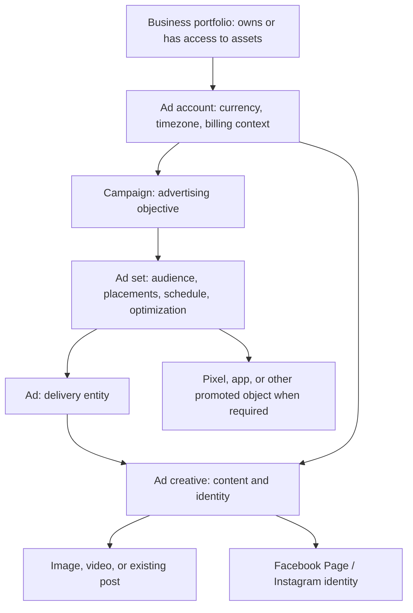
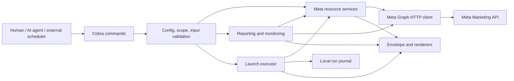

# adsctl: architecture and product design

Implementation is now available. This document preserves the design rationale; see [implementation status](implementation.md) for the current behavior and remaining validation gaps.

Status: initial design, now implemented with the limits recorded above. Research date: 2026-10-09. Authenticated Meta API testing has not been performed.

## 1. Recommendation and scope

Build adsctl as a Go and Cobra CLI that exposes each advertising platform's native resources through consistent commands and output. Start with Meta. Give an AI agent reliable primitives for account discovery, configuration inspection, performance analysis, and explicit advertising changes. Add workflow commands for reporting, monitoring, and complete campaign creation.

```text
adsctl <platform> <resource> <action> [ID] [flags]

adsctl meta campaigns list --profile agency --account act_123
adsctl meta insights query --profile agency --account act_123 --level campaign --date-preset last_7d
adsctl meta campaigns pause 456 --profile agency-write --account act_123
adsctl meta launch plan --file launch.yaml --profile agency-write --account act_123 --save plan.json
```

The agent interprets evidence and decides what to do; adsctl gathers data and executes defined operations. The initial product needs no embedded LLM, hosted backend, or scheduler.

Confirmed requirements:

- Go, Cobra, and the name `adsctl`.
- Platform namespaces: `adsctl meta ...`; Google later.
- An AI agent is the primary caller, operating across multiple businesses/clients.
- Support shared credentials with access to multiple accounts and separate client credentials.
- External tokens initially, referenced through environment variables or secret files.
- JSON by default, preserving Meta fields inside a consistent envelope; optional table output.
- No interactive prompts, predictable exit codes, separate diagnostics.
- Inspection and reporting are the first implementation milestone. The expanded product design includes monitoring, management, and creation.

Command names, defaults, schemas, and architecture choices below are recommendations. They are not already implemented or individually approved decisions.

## 2. Understanding Meta's API

The integration is with the **Meta Marketing API**, built on Graph API. **Ads Manager** is Meta's graphical advertising product. adsctl calls the API directly.



An agency can access a client's account without owning it. A credential represents an authorized identity, not an ad account; select the account separately on each command.

| Concept | Purpose | CLI resource |
| --- | --- | --- |
| Ad account | Advertising container with currency, timezone and billing context | `accounts` |
| Campaign | Objective, campaign budget where used, status | `campaigns` |
| Ad set | Audience, placements, schedule, bidding, optimization, ad-set budget where used | `adsets` |
| Ad | Parent ad set, creative association and delivery status | `ads` |
| Creative | Copy, destination, media references, advertiser identity and format | `creatives` |
| Media | Uploaded images and videos | `images`, `videos` |
| Supporting assets | Pages, Instagram identities, pixels, existing audiences | Discovery commands |
| Insights | Performance at account, campaign, ad-set or ad level | `insights` |

Budgets can belong to campaigns or ad sets. Read the current configuration before changing one. Meta distinguishes daily and lifetime budgets, and budget inputs use the account currency's minimum denomination. Daily budgets are average spending settings; do not describe them as strict daily ceilings. [Overview](https://developers.facebook.com/documentation/ads-commerce/marketing-api/overview.md), [budgets](https://developers.facebook.com/documentation/ads-commerce/marketing-api/bidding/overview/budgets.md), [campaign budgets](https://developers.facebook.com/documentation/ads-commerce/marketing-api/bidding/guides/advantage-campaign-budget.md).

Configured status and effective status differ. An ad requested as `ACTIVE` can remain blocked by a paused parent or another delivery condition. Activation success does not prove delivery. Creative content is generally changed by creating another creative and attaching it to an ad; only limited metadata supports updates in place. [Status behavior](https://developers.facebook.com/documentation/ads-commerce/marketing-api/best-practices/manage-your-ad-object-status.md), [creative update fields](https://github.com/facebook/facebook-python-business-sdk/blob/efd8423a2e595ea8d4c04eb824ce113f2f1d68cd/facebook_business/adobjects/adcreative.py).

Resource reads answer “what is configured?” Insights reads answer “what happened?” Insights are exposed on account, campaign, ad-set and ad edges. Fields, dates, attribution settings and breakdowns define a report. [Insights API](https://developers.facebook.com/documentation/ads-commerce/marketing-api/insights.md).

## 3. Features and delivery sequence

| Stage | Features | Outcome |
| --- | --- | --- |
| 1A: discovery | Profiles, auth checks, accounts, resource list/get, fields, pagination, command schemas | Agent can understand an account and locate objects |
| 1B: reporting | Insights, async report jobs, summary/compare/rank/breakdown, exports | Agent can answer performance questions reproducibly |
| 2: monitoring | Delivery issues, activity, available Meta recommendations, snapshots/diffs, portfolios, monitoring rules | Agent can check clients and explain changes |
| 3: management | Pause/activate, budget changes, supported updates, archive/delete, creative replacement, mutation receipts | Agent can make and verify targeted changes |
| 4: creation | Media uploads, creatives/previews, campaigns/ad sets/ads, launch plan/apply/resume | Agent can prepare and activate a complete campaign |
| Later | Further objectives/formats, catalogs, customer-file audiences, webhook receiver, Google | Broader coverage within the same interface |

Read all supported Meta objectives from the start. Guided creation should first cover image/video website traffic, then website sales using existing tracking assets, followed by carousel and existing-post workflows. Lead forms, app/messaging/catalog campaigns and specialized Advantage+ configurations need separately validated templates. A field appearing in an SDK does not establish that every combination is supported.

Meta already publishes an official Ads CLI. Use it as a UX benchmark. adsctl's proposed value is one Go executable, multiple platforms, explicit credential routing, an agent output contract, and resumable workflows. Integrate directly with Marketing API rather than shelling out to the official CLI. [Official Ads CLI](https://developers.facebook.com/documentation/ads-commerce/ads-ai-connectors/ads-cli/ads-cli-overview.md).

## 4. Authentication and client selection

An operator configures a Meta developer app, obtains permissions and asset access, generates a user or system-user token, and provisions that secret outside adsctl. Prefer system-user tokens for unattended business automation where the business setup permits; accept user tokens too. Tokens and asset grants can become invalid, so check validity rather than assuming indefinite access. [Authentication](https://developers.facebook.com/documentation/ads-commerce/marketing-api/get-started/authentication.md).

Reporting requires `ads_read`; management requires `ads_management`. Business discovery and Page/Instagram-related operations can require additional scopes and asset assignments. Serving other businesses involves Meta's permission access requirements and App Review. Permission access levels and Marketing API rate-limit tiers are distinct. [Authorization](https://developers.facebook.com/documentation/ads-commerce/marketing-api/get-started/authorization.md).

`auth check` inspects available token information and performs a small account read. Return separate results for token validity, scopes when inspectable, account access and local CLI mode. Token debugging may need app credentials; unavailable information is `unknown`. A successful read does not prove permission to create every resource or use every supporting asset.

Store non-secret configuration at `~/.adsctl/config.yaml`, or `$ADSCTL_HOME/config.yaml` when overridden. The same home contains `bin/`, optional `secrets/`, and `state/`. Explicit `--config` and `--state-dir` still select other locations, including legacy installations. Relative token-file references resolve from the selected config file's directory:

```yaml
version: 1
default_profile: agency-read
profiles:
  agency-read:
    platform: meta
    token_env: META_AGENCY_READ_TOKEN
    api_version: v25.0
    mode: read
  agency-write:
    platform: meta
    token_file: /run/secrets/meta-agency-write-token
    api_version: v25.0
    mode: write
  client-b:
    platform: meta
    token_env: META_CLIENT_B_TOKEN
    api_version: v25.0
    mode: read
portfolios:
  clients:
    - profile: agency-read
      account: act_123
    - profile: client-b
      account: act_789
```

Require exactly one token source per profile. Token files contain a raw token with optional trailing newline. Do not store token values in config, print them, accept token flags, or try another profile after an authorization error. Optional app-secret references support app-secret proof and token inspection where needed.

Read selection precedence is flag, `ADSCTL_PROFILE`/`ADSCTL_ACCOUNT`, then configured default profile (profile only). Account-scoped commands require an account; discovery does not. Never choose the first accessible account automatically. Advertising mutations require explicit `--profile` and `--account`; verify target object membership. A launch plan records these selections and execution requires matching flags.

`mode: read` locally rejects advertising mutations, including uploads. It permits POST-based reporting jobs because these do not change advertising. This convenience does not replace Meta's actual permission enforcement.

### API version policy

Use a version per profile and include it in results. Propose **v25.0 as the initial compatibility baseline**, subject to live smoke testing before release: Meta's published version table lists it as available, while the inspected SDK snapshot declares v26.0. Neither proves the newest behavior supported by every account. [Version table](https://developers.facebook.com/documentation/ads-commerce/marketing-api/marketing-api-changelog/versions.md), [SDK configuration](https://github.com/facebook/facebook-python-business-sdk/blob/efd8423a2e595ea8d4c04eb824ce113f2f1d68cd/facebook_business/apiconfig.py).

Maintain tested, version-scoped schemas; expose provider-reported version information when available. Review versioned and out-of-cycle changes before upgrading. Pinning cannot prevent changes Meta applies to all versions. [Versioning](https://developers.facebook.com/documentation/ads-commerce/marketing-api/overview/versioning.md).

## 5. Architecture



| Module | Responsibility |
| --- | --- |
| Cobra commands | Arguments, help, examples, dispatch; no HTTP logic |
| Configuration | Profiles, token references, account/version resolution, local read/write mode |
| Meta HTTP client | Versioned requests, auth, multipart upload, paging, throttling, errors, tracing |
| Resource services | Account/resource operations and endpoint-specific validation |
| Reporting | Query compilation, jobs, comparisons, labeled derived metrics |
| Monitoring | Rules and deduplicated findings backed by evidence |
| Launch executor | Dependencies, paused creation, checkpoints, uncertain-step reconciliation |
| Output | Versioned envelopes, JSON/JSONL/table; CSV for export commands |
| Local state | Job metadata, snapshots, launch journals and monitoring state |

```text
cmd/adsctl/main.go
internal/cli/                 # Cobra tree and command metadata
internal/config/              # profiles, portfolios, secret references
internal/output/              # envelopes, renderers, exit codes
internal/platform/meta/
    graph/                    # HTTP, auth, paging, throttling, errors
    resources/                # accounts, campaigns, ad sets, ads, creatives, media
    insights/                 # query and report-run APIs
    schema/                   # version-scoped capabilities
internal/reporting/
internal/monitoring/
internal/launch/
internal/state/
docs/
```

Use Go `net/http`, request contexts and `encoding/json`, plus Cobra and a YAML decoder. Keep native data lossless using `json.RawMessage` or maps; type the routing, metadata and supported write inputs. IDs remain strings; monetary values use exact strings/decimal arithmetic. Never round-trip arbitrary IDs through `float64`.

Start with versioned local files, atomic replacement and per-run locks. No database/server dependency. File locking coordinates a machine's processes, not multiple hosts; distributed execution would need shared ownership and storage.

When Google is added, reuse config/output/command conventions, but give it separate models and adapters. Do not force Meta ad sets and Google ad groups into one write model. Any later cross-platform metrics need explicit definitions and attribution differences.

## 6. Reporting and monitoring

`insights query` exposes native fields and reporting parameters. Require an explicit date preset or complete date range; no silent lifetime queries. Return the resolved query, account timezone/currency, fetch time, attribution mode, completeness and warnings alongside native rows.

Use account queries with `--level` for comparisons and object-scoped queries for focused investigations. Expensive reports use explicit async submission, polling and retrieval. Submission returns a job ID immediately unless `--wait` is supplied. Provider report jobs have limited retention; exported results are the durable artifact. [Insights best practices](https://developers.facebook.com/documentation/ads-commerce/marketing-api/insights/best-practices.md).

Higher-level reports return structured evidence:

- `summary`: account metrics, contributors and delivery issues.
- `compare`: two resolved periods, absolute and relative changes.
- `rank`: entities ranked by a metric after complete population retrieval.
- `breakdown`: available geographic, demographic or delivery dimensions.
- `export`: complete rows plus reproducibility metadata.

Correctness rules:

- Preserve action/value/ROAS arrays. Derived CPA or ROAS needs an explicit action type; never sum overlapping conversion categories.
- Distinguish all clicks from link clicks; label each rate's denominator.
- Missing, withheld or unavailable data is not zero.
- Reach/unique metrics are not additive across rows; request the required aggregate. Recompute ratios from valid totals instead of averaging ratios.
- Keep currencies separate in portfolio output; no implicit conversion.
- Resolve reporting dates in account timezone. Mark current-day results partial; higher-level comparisons default to completed periods.
- Fix attribution and action-report-time settings across comparisons. Return a null percentage change with a reason when the baseline is zero.
- Allow an explicit conversion-lag buffer; record observation time because recent data can change.

Meta restricts metric/breakdown combinations and older reach reporting. Since August 6, 2026, some breakdowns also require account opt-in. Empty responses can indicate unavailability; async retries must not be promised to bypass access requirements. [Breakdowns](https://developers.facebook.com/documentation/ads-commerce/marketing-api/insights/breakdowns.md), [2026 changes](https://developers.facebook.com/documentation/ads-commerce/marketing-api/out-of-cycle-changes/occ-2026.md).

`monitor check` performs one bounded evaluation and exits. An external scheduler or agent invokes it. Rules cover spend, explicitly defined CPA/ROAS, no delivery, rejected ads, configuration changes, credentials and unavailable reporting. Require minimum evidence and a time window for performance rules. Fatigue/overspend projections are labeled heuristics.

Results distinguish `ok`, `firing`, `insufficient_data`, `unavailable` and `error`. Findings carry resource IDs, currency/timezone, period, values, thresholds and evidence queries. Deduplication uses rule/profile/account/object/window; recovery is a separate event. The CLI produces findings and does not automatically send messages or change ads.

Optional later webhooks require a reachable HTTPS receiver, separate deployment and subscription management. Notifications still lead to API reads for current details. [Ads webhooks](https://developers.facebook.com/documentation/ads-commerce/marketing-api/ads-webhooks/ads-webhooks-overview.md).

## 7. Management and creation

Writes use IDs, not names; names may be duplicated. Common changes get clear verbs (`pause`, `activate`, `budget set`). Advanced supported updates use native JSON files. Omitted fields stay untouched; parent activation does not silently rewrite child statuses.

Every mutation supports local `--dry-run`, returning intended requests without advertising changes. Remote `validate` is separate and uses Meta's `validate_only` only where supported by the endpoint/version. Record unavailable or deferred checks. Validation does not guarantee review approval or delivery. [Execution options in Meta SDK resource definitions](https://github.com/facebook/facebook-python-business-sdk/tree/efd8423a2e595ea8d4c04eb824ce113f2f1d68cd/facebook_business/adobjects).

Mutation receipts include scope, changed fields, provider response, resulting IDs and a verification read. Distinguish `applied`, `applied_unverified`, `unknown` and `failed`. A verification failure after a successful write is not permission to repeat a create. Archive/delete remain explicit lifecycle operations; archive is not a reversible pause. [Status lifecycle](https://developers.facebook.com/documentation/ads-commerce/marketing-api/best-practices/manage-your-ad-object-status.md).

### Individual resources

Create media, campaign, ad set referencing the campaign, creative referencing media/identity, and ad referencing the ad set/creative. Media/creative preparation can occur independently of campaign creation. Poll video processing before using the asset.

New campaigns/ad sets/ads default to `PAUSED`. Individual creation allows explicitly requested `ACTIVE`; complete launch workflows create paused resources and activate separately. Require objectives and applicable special-ad-category declarations; do not infer regulated categories from copy. Nested targeting/creative data comes from files/stdin. [Campaign](https://developers.facebook.com/documentation/ads-commerce/marketing-api/get-started/basic-ad-creation/create-an-ad-campaign.md), [ad set](https://developers.facebook.com/documentation/ads-commerce/marketing-api/get-started/basic-ad-creation/create-an-ad-set.md), [creative](https://developers.facebook.com/documentation/ads-commerce/marketing-api/get-started/basic-ad-creation/create-an-ad-creative.md), [ad](https://developers.facebook.com/documentation/ads-commerce/marketing-api/get-started/basic-ad-creation/create-an-ad.md).

### Complete launch workflow

`launch` creates a named resource graph; it is not general desired-state reconciliation. A versioned YAML manifest contains native Meta payloads, local reference keys and asset paths.

1. `launch plan` checks scope/prerequisites, hashes files and produces an ordered plan. It creates no media or advertising objects. Checks are marked local, remote, skipped or deferred.
2. `launch apply --plan` verifies scope/version/hashes, locks a local run, creates paused resources in dependency order, and checkpoints each ID.
3. `launch resume RUN_ID` reconciles the journal and continues known unfinished steps.
4. `launch activate RUN_ID` checks readiness and activates only resources recorded in the run. For new campaigns, activate the parent campaign last.

A local run ID or reference key is not a Meta idempotency key. An ambiguous create timeout marks the step `unknown` and stops dependent work. Resume requires a verified remote ID or an explicitly recorded decision to retry that step. Do not use matching names as proof of identity.

No transaction covers the entire launch. Preserve successful resources paused on partial failure and report recovery actions; no automatic rollback or deletion. Applying a manifest does not delete resources omitted from it. Existing active parents cannot guarantee that partial activation stays inactive. Graph batches do not supply workflow atomicity. [Async/batch APIs](https://developers.facebook.com/documentation/ads-commerce/marketing-api/asyncrequests.md).

## 8. Reliability and release criteria

The [CLI UX and command reference](cli-reference.md) defines the complete proposed interface.

Retry reads with bounded exponential backoff/jitter, inspect Meta codes/subcodes as well as HTTP status, and pace from returned usage information. Bound concurrency per account. Observed utilization is not a guaranteed remaining quota because other processes may share the app/account. [Rate limiting](https://developers.facebook.com/documentation/ads-commerce/marketing-api/overview/rate-limiting.md), [errors](https://developers.facebook.com/documentation/ads-commerce/marketing-api/error-reference.md).

Never automatically repeat ambiguous creates. Reconcile updates before retrying. Do not retry authorization or validation errors as transient. Support deadlines and Ctrl-C; preserve report IDs and launch journals. Redact secrets in URLs, logs, errors and files. Classify commands by semantic effect: a POST reporting job is not an advertising mutation.

Generate `commands`, operation schemas, help and agent Markdown docs from shared command metadata. Provider/user resource text remains untrusted data. Schema output describes the supported adapter subset, not a promise of complete Meta API coverage.

Validate with HTTP fixtures for paging/errors/retries, golden CLI output tests, report fixtures for missing data/attribution/currency, and workflow crash/partial-failure simulations. Before release, use a designated account for live discovery and sync/async reporting smoke tests. Later test paused creation, updates, previews and cleanup. Local validation does not establish live eligibility or delivery.

Implement discovery/reporting first. [Meta research notes](meta-research.md) record the evidence and remaining API-validation work.
